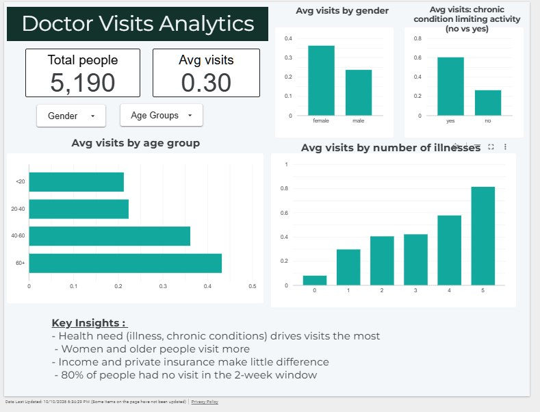

# Doctor Visits Analytics

Exploratory data analysis of 5,190 survey records to find out **what drives how often people visit a doctor**: health need, age, gender, income or insurance.

**[View the live dashboard](https://datastudio.google.com/reporting/46fdf7be-f63f-44c8-a4cc-dababb423d41)**



## Problem
Which factors are most closely related to the number of doctor visits in a 2-week period?

## Dataset
Australian health survey data (5,190 people, 12 columns, no missing values).

| Column | Meaning |
|---|---|
| `visits` | Doctor consultations in the past 2 weeks |
| `gender` | Male or female |
| `age` | Age (stored as age/100, converted to years) |
| `income` | Annual income (stored in $10,000 units, converted to dollars) |
| `illness` | Number of illnesses in the past 2 weeks |
| `reduced` | Days of reduced activity in the past 2 weeks |
| `health` | General health questionnaire score |
| `private` | Has private health insurance |
| `freepoor` | Free government cover due to low income |
| `freerepat` | Free government cover due to old age, disability or veteran status |
| `nchronic` | Chronic condition that does not limit activity |
| `lchronic` | Chronic condition that limits activity |

## Tools
Python (Pandas, NumPy, Matplotlib, Seaborn), Jupyter Notebook, Looker Studio

## What I did
1. Cleaned the data: dropped the index column, converted age and income to real units, checked for missing values.
2. Created `age_group` (<20, 20-40, 40-60, 60+) and a `visited` flag (visits > 0).
3. Explored distributions, group averages, correlations and insurance coverage with charts.
4. Built an interactive dashboard with gender and age group filters.

## Key findings
- **80% of people had no doctor visit** in the 2-week window, so visits are heavily skewed.
- **Health need drives visits the most.** Average visits rise from 0.08 (no illness) to 0.81 (5 illnesses). People whose chronic condition limits activity visit about 2.3x more (0.60 vs 0.26).
- **Women visit more than men** (0.36 vs 0.24).
- **Older people visit more:** 0.43 for ages 60+ vs 0.21 for under 20.
- **Income and private insurance matter little.** Income has almost no correlation with visits (-0.08), and private insurance holders average 0.30 vs 0.31 for those without.
- People with free cover due to low income visit less (0.16 vs 0.31). This could point to an access gap, but this data alone can't prove it.

## Limitations
- Survey data from 1977-78 and self-reported.
- Only a 2-week window, so one visit pattern may not represent a whole year.
- The analysis shows associations, not causes.

## Files
- `Doctor_Visit_Analytics.ipynb`: cleaning, analysis and charts
- `DoctorVisits.csv`: original dataset
- `DoctorVisits_clean.csv`: cleaned data used in the dashboard
- `dashboard.jpg`: dashboard screenshot

## How to run
```bash
git clone https://github.com/YOUR_USERNAME/doctor-visits-analytics.git
cd doctor-visits-analytics
pip install pandas numpy matplotlib seaborn jupyter
jupyter notebook Doctor_Visit_Analytics.ipynb
```

## Author
Shruti Halle | [GitHub](https://github.com/YOUR_USERNAME)
